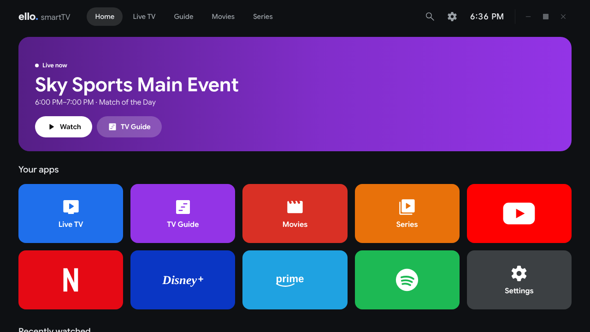
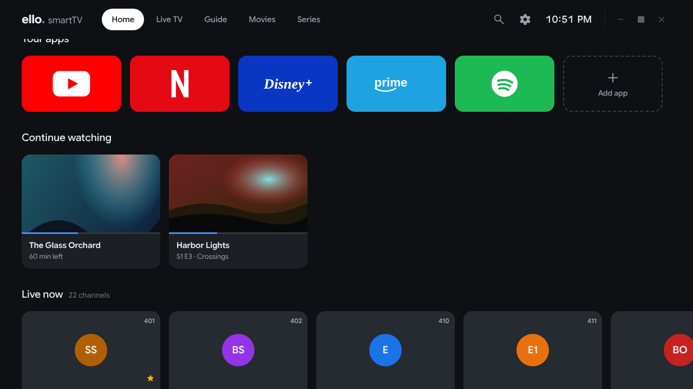
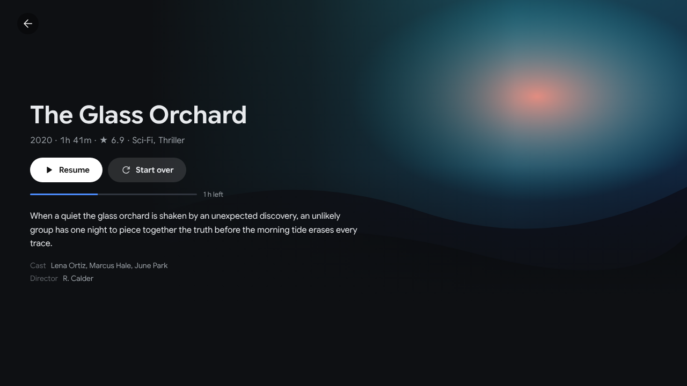
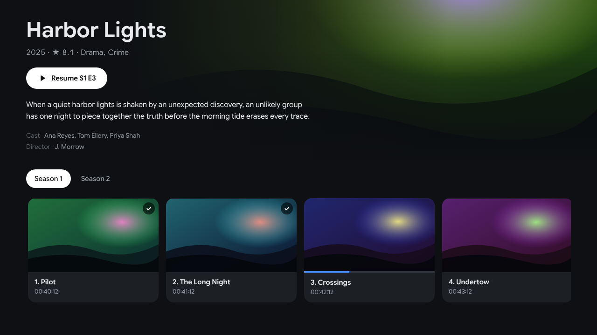
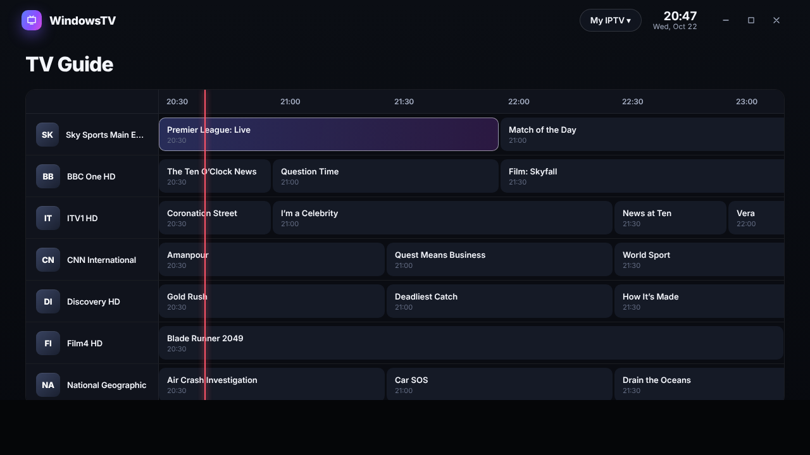
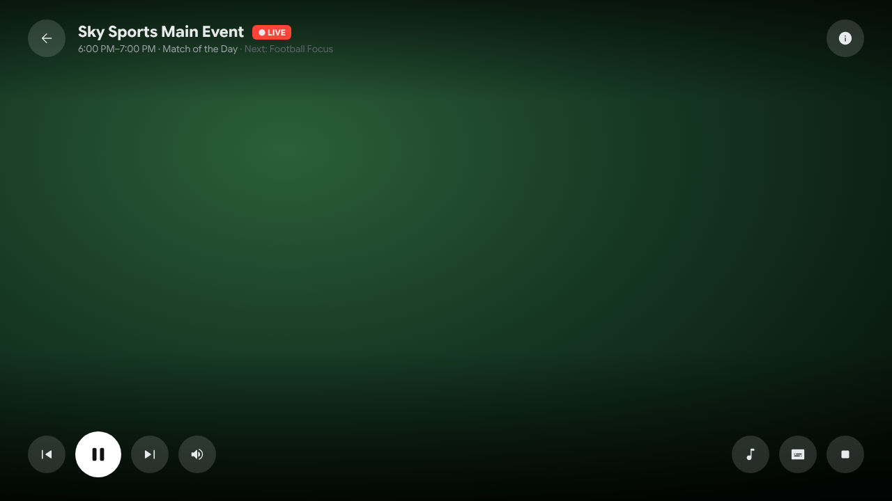
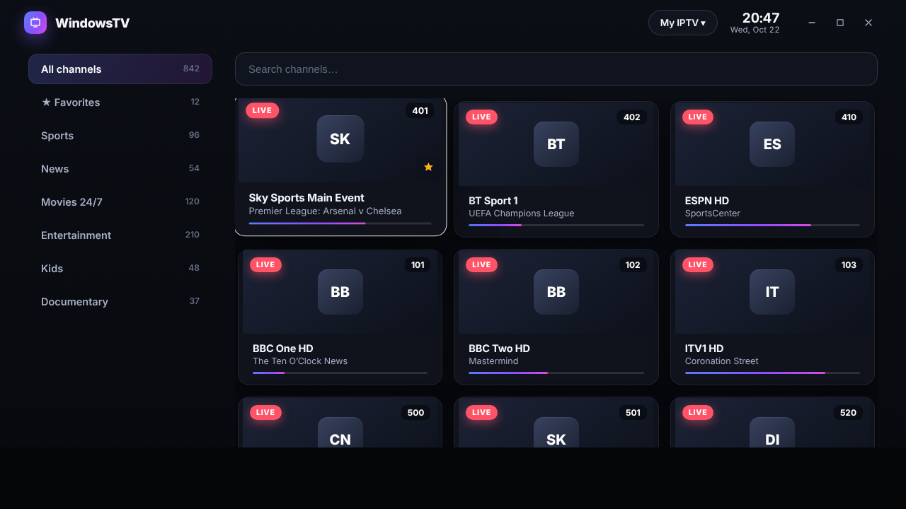

# ello smartTV

A high-quality **smart-TV launcher + IPTV player for Windows**, built on
[Electron](https://www.electronjs.org/) with [**mpv**](https://mpv.io/) as the
playback engine.

It gives you the classic "big-screen TV" experience — a tiled home screen with
app buttons, a Live TV grid, a scrolling EPG guide, Movies & Series (VOD) — and
plays IPTV at a quality level that aims well past apps like UHF, because video
goes through mpv (`gpu-next`, hardware decoding, proper deinterlacing) rather
than a browser video element.

> **Status:** v0.1 foundation. The full app is implemented (UI, mpv backend,
> Xtream + M3U, EPG) and type-checks + builds cleanly. It is designed to be run
> and packaged **on Windows** (mpv is a Windows binary and the video embedding
> uses the Win32 window handle). See *Getting mpv* below.

---

## Screenshots

> Captured from the **real app UI** running with sample channel/EPG data. Real
> channel logos and posters load from your provider at runtime, and in the
> player the picture comes from mpv (shown here as a placeholder). The movie
> artwork in these shots is generated placeholder imagery.

| Home | Continue watching |
| :---: | :---: |
|  |  |
| **Movie details** | **Series details** |
|  |  |
| **TV Guide (with catch-up)** | **Player** |
|  |  |
| **Live TV** | |
|  | |

---

## Download the app (.exe)

A GitHub Actions workflow (`.github/workflows/build.yml`) builds the real Windows
executables on a Windows runner, with **mpv bundled in**, every time this branch
is pushed. Two files are produced:

- **`ello-smartTV-<version>-Setup.exe`** — the installer: ello smartTV's own
  setup window (dark, rounded, one **Install** button, with an optional install
  folder and desktop shortcut). It installs per-user, so no admin prompt.
- **`ello-smartTV-<version>-Portable.exe`** — a single self-contained `.exe` you can
  run directly, no install.
- `ello-smartTV-<version>-Setup-Classic.exe` — the plain Windows-wizard
  installer. The setup window runs this one in the background, and
  auto-update uses it too.

The setup window lives in `installer/` (WPF on .NET Framework 4.8, which ships
with Windows 10/11). `scripts/build-custom-installer.ps1` builds it and appends
the classic installer to it.

**To get the EXE:** open the repo's **Releases** page and download the `.exe`
from the newest **“ello smartTV — build N”** pre-release. Every push publishes a
new one automatically. Pushing a version tag like `v0.1.0` attaches the EXEs to
that version's release instead.

### Automatic updates

Install the **Setup.exe** once and the app keeps itself up to date: it checks
for a new build shortly after launch and every few hours, downloads it in the
background, and installs it when you close the app (or right away from
**Settings → About & updates**). The portable EXE can't update itself — just
download a newer one.

Updates are served from a separate **public** repo, `ello-smarttv-releases`, so
this source repo can stay private. To switch it on (one time):

1. Create a public GitHub repo named **`ello-smarttv-releases`** (tick *Add a README*).
2. Create a **fine-grained personal access token** with access to only that repo
   and **Contents: Read and write**.
3. In this repo go to **Settings → Secrets and variables → Actions** and add it
   as a secret named **`RELEASES_TOKEN`**.

Every build after that also publishes `v0.1.<build>` to the releases repo,
which is the feed installed copies update from.

Because the build is unsigned, Windows SmartScreen may warn on first launch
(**More info → Run anyway**). Prefer building it yourself? See *Build a Windows
installer* below.

---

## Why it's higher quality than UHF

Two specific UHF pain points drove the design:

| UHF problem | What ello smartTV does |
| --- | --- |
| **EPG is flaky / shifted / missing** | A dedicated XMLTV engine that honours per-programme timezone offsets, falls back to fuzzy channel-name matching when `tvg-id` doesn't line up, caches the guide to disk with a TTL (and keeps a stale copy if a refresh fails), and tolerates malformed/gzipped/huge guide files. |
| **"Nothing loads" with no explanation** | Every load path reports a *reason*. The HTTP layer retries with backoff and maps status codes to plain English (401 → "check your login", 403 → "subscription/User-Agent blocked", …). The player has a **load watchdog**: if a stream doesn't start in time you get an explanation and a **Retry** button, never a silent black screen. |
| Playback quality | mpv with `--vo=gpu-next`, `--profile=high-quality`, hardware decode, deinterlacing for broadcast feeds, a large network cache and **ffmpeg auto-reconnect** so IPTV jitter doesn't kill the stream. |

---

## Features

- 📺 **Modern TV home screen** — cinematic hero spotlight + horizontal content
  rows (Apple TV / Google TV style), with an app launcher.
- 🧩 **Real apps on the home screen** — open web apps like **YouTube inside
  ello smartTV** (an in-app browser), or launch **installed Windows apps**
  (Netflix, Spotify, Prime Video…) you add yourself. (Streaming sites that use
  DRM only play through their installed app, not their website — see below.)
- 🎮 **Remote/D-pad navigation** — arrow keys move focus to the nearest tile,
  Enter selects, Backspace/Esc goes back. Mouse works too.
- 📡 **IPTV sources** — **Xtream Codes** logins *and* **M3U/M3U8** playlists
  (URL or local file). Add several and switch between them.
- 🗂️ Categories, search, **favorites**, recently-watched.
- 🕗 **EPG** — now/next on every channel card, plus a full scrolling **TV Guide**
  grid with a live "now" line.
- 🎬 **Movies & Series (VOD)** with poster browsing and Google-TV-style
  **detail pages** — full-bleed artwork, plot, cast, season tabs and an
  episode row with watched ticks.
- ▶️ **Continue watching** — movies and episodes remember where you stopped;
  **Resume** or **Start over**, and series pick up at the next episode
  (with an "up next" countdown at the end of each one).
- ⏪ **Catch-up TV** — on channels your provider archives (Xtream
  `tv_archive`, or M3U `catchup` attributes), pick a past programme in the
  TV Guide and watch it from the start.
- ⚡ **Channel zapping** (prev/next, or type a channel number) and a polished
  player overlay: channel logo, now/next mini-guide, seek bar with time left,
  and live stats (resolution, codecs, bitrate, buffer).
- 🔄 **Automatic updates** (installer version) — see above.
- 🛠️ Tunable player settings: hardware-decode mode, cache size, timeouts,
  deinterlacing, User-Agent (global and per-source).

---

## Requirements

- **Windows 10/11** (to run with video; development tooling is cross-platform).
- **Node.js 20.11+** and npm.
- **mpv** (see below).

## Getting mpv

ello smartTV looks for mpv in three places, in order:

1. a path you set in **Settings → Playback engine**,
2. a bundled copy at `resources/mpv/mpv.exe`,
3. an `mpv` already on your system `PATH`.

So the easiest option is to **install mpv** (e.g. `winget install
mpv` or `choco install mpv`, or download from <https://mpv.io/installation/>)
and ello smartTV will find it automatically.

To **bundle** mpv into a packaged build, put a Windows mpv build (so that
`mpv.exe` sits directly inside) in `resources/mpv/`. Running `npm install`
attempts to download one automatically via `scripts/fetch-mpv.mjs` (it needs
7-Zip on PATH to extract the `.7z`); if that can't run, the script prints manual
steps. Recommended builds: <https://github.com/zhongfly/mpv-winbuild/releases>.

## Run in development

```bash
npm install          # also tries to fetch mpv on Windows
npm run dev          # launches Electron with hot-reload
```

## Build a Windows installer

```bash
npm run build:win    # NSIS installer in release/
```

(`npm run build` just compiles; `npm run build:unpack` produces an unpacked
app folder for quick testing.)

## Adding a source

Open **Settings → Sources → Add**:

- **Xtream Codes:** enter the **Server URL** (`http://host:port`), **username**
  and **password**. Live TV, Movies, Series and EPG are fetched automatically.
  Hit **Test connection** to verify before saving.
- **M3U playlist:** enter the playlist **URL or file path**. If the playlist
  references an EPG (`url-tvg`/`x-tvg-url`) it's picked up automatically;
  otherwise add an **XMLTV URL** in the source form.

If a provider rejects you, set a **custom User-Agent** on the source (many IPTV
panels only allow specific UAs — the default is a VLC UA, which most accept).

## Controls

| Key | Action |
| --- | --- |
| Arrows | Move focus / (in player) channel up-down, seek (VOD) |
| Enter | Select / play |
| Space | Play / pause |
| Backspace / Esc | Back (close player → home) |
| `F` | Favorite the highlighted channel (Live TV) |
| `M` | Mute |
| `+` / `-` | Volume up / down (player) |
| `0`–`9` | Type a channel number to jump to it (player) |

---

## Architecture

```
src/
├── shared/            # types + IPC channel names shared by all processes
├── main/              # Electron main process (Node)
│   ├── index.ts         app lifecycle, wiring
│   ├── windows.ts       layered video + transparent-UI window compositor
│   ├── ipcHandlers.ts   all IPC endpoints (wrapped so errors surface to UI)
│   ├── store.ts         persisted settings (electron-store)
│   ├── net/http.ts      resilient fetch: retries, timeouts, gzip, UA, probes
│   ├── updater.ts       auto-update (electron-updater, public releases repo)
│   ├── progress.ts      watch progress for Continue watching / resume
│   ├── mpv/             MpvPlayer (JSON-IPC) + binary resolver
│   └── services/        xtream · m3u · epg · catalog · catchup
├── preload/           # contextBridge-exposed, typed `window.api`
└── renderer/          # React UI (zustand + custom spatial navigation)
    └── src/{pages,components,hooks,styles}
```

**How video is composited:** mpv renders into its own borderless, non-focusable
window (`--wid`), and the React UI runs in a transparent window kept exactly in
front of it. mpv has no input bindings, so the UI window always owns keyboard and
mouse — avoiding the click-through fragility that plagues other Electron+mpv
apps. To show video in a region (fullscreen, or a preview pane later) the video
window is simply moved/resized to that rectangle; to hide it, it's hidden. See
the diagram in `src/main/windows.ts`.

## Known limitations / roadmap

- Video playback and the window compositing require **Windows** (Win32 `--wid`);
  the current build targets Windows only.
- Stalker/MAC portals are not implemented (M3U + Xtream only for now).
- Streaming services that use **Widevine DRM** (Netflix, Disney+, Prime Video,
  Max…) can't play in the in-app browser — stock Electron has no Widevine CDM.
  Add them as **installed-app** tiles instead (they launch the real Windows app).
- Catch-up needs provider support (archived channels show a ⟲ badge in the
  guide). Multi-view is future work.
- Series episode browsing requires an Xtream source.

## License

MIT
